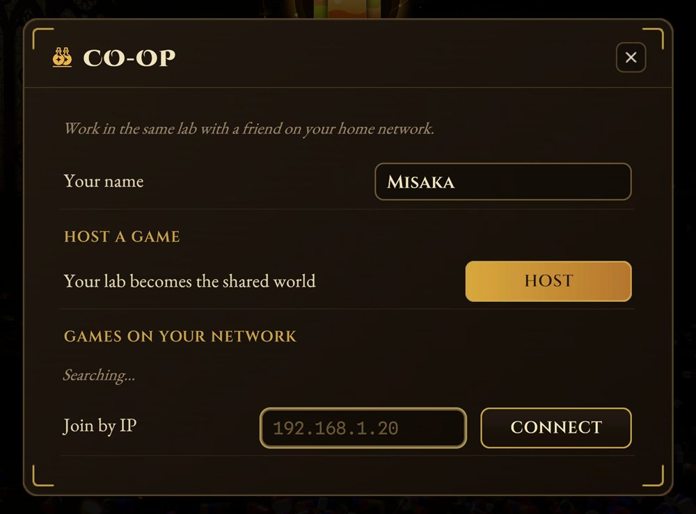

# A Place for Every Potion – Co-op Mod

Play **A Place for Every Potion** together: two PCs on the same home network, one shared lab.

- **One lab, two players.** The host's save is the world. Bottles, shelves, vats, the Essence Separator and the cat are shared, and every pick-up, pour and throw shows up on the other PC.
- **Your own level.** XP and skills stay yours. The first time you join someone you start fresh or at their level, and your solo save is never touched.
- **No liquid gets lost.** The worlds keep checking each other and repair any difference.

## Install (both PCs)

1. Install [MelonLoader 0.7.x](https://github.com/LavaGang/MelonLoader/releases) into the game folder and start the game once.
2. Download the zip from [Releases](https://github.com/csermet/A-Place-for-Every-Potion-Coop-Mod/releases) and copy its `Mods` folder into the game folder.
3. When Windows asks about network access, allow it for private networks.

Both PCs need the same game version (tested with 1.2.6) and the same mod version.

## Play

**Host:** main menu → **Co-op** → **HOST**.
**Join:** main menu → **Co-op** → **JOIN** next to your friend's game, or type their IP.

If the list stays empty, check that both PCs are on the same network with a *Private* profile, or run `PotionCoop_firewall.bat` from the zip as administrator. Logs are in `MelonLoader/Latest.log`.

---

Unofficial fan mod, not affiliated with the game's developers. Undo is off while connected. Build from source with `dotnet build -c Release` (the game in `..\game`, MelonLoader installed). [MIT license](LICENSE).
